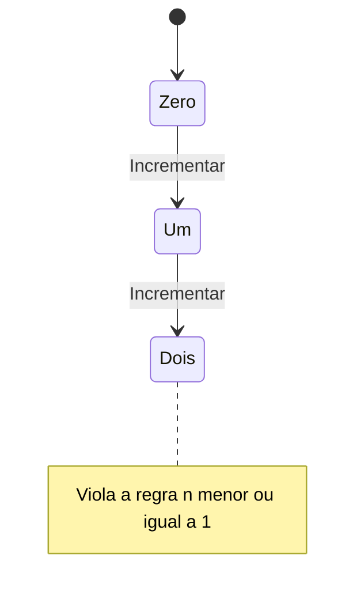

# Executar TLC no Windows

Use Java 11 ou posterior já disponível e `tla2tools.jar` do release 1.7.4,
que se identifica como TLC 2.19 na execução. A versão e
o SHA-256 abaixo são os fixados pelo pstack na revisão registrada em
[EXTERNAS.md](../../EXTERNAS.md#importação-do-cursor-plugins-em-27102026).
O download vem do [release oficial](https://github.com/tlaplus/tlaplus/releases/tag/v1.7.4).
Isso não muda dependências do projeto nem configura o Convex.

## Preparar uma execução isolada

No PowerShell, confira `java -version`. Crie uma pasta nova sob `$env:TEMP`
e baixe a ferramenta com integridade conferida:

```powershell
$statechartDir = Join-Path $env:TEMP ('fnfe-statechart-' + [guid]::NewGuid().ToString('N'))
New-Item -ItemType Directory -Path $statechartDir | Out-Null
$statechartJar = Join-Path $statechartDir 'tla2tools.jar'
Invoke-WebRequest -UseBasicParsing -Uri 'https://github.com/tlaplus/tlaplus/releases/download/v1.7.4/tla2tools.jar' -OutFile $statechartJar
$statechartHash = (Get-FileHash -LiteralPath $statechartJar -Algorithm SHA256).Hash.ToLowerInvariant()
if ($statechartHash -ne '936a262061c914694dfd669a543be24573c45d5aa0ff20a8b96b23d01e050e88') {
    throw 'Checksum do TLC divergente; não execute o arquivo.'
}
```

Se Java ou o download estiver indisponível, registre a pré-condição faltante.
Não troque silenciosamente de versão ou instale um runtime global. Preserve
os artefatos da execução pelo tempo necessário à revisão.

## Conferir a ferramenta com um modelo sintético

Este exemplo só verifica um contador limitado. Não representa o protocolo
de operações do produto. Grave os dois arquivos com UTF-8 sem BOM:

```powershell
$statechartUtf8 = New-Object System.Text.UTF8Encoding($false)
$statechartSpec = @'
--------------------------- MODULE Counter ---------------------------
EXTENDS Naturals
VARIABLE n
vars == <<n>>
Init == n = 0
Increment == /\ n < 2
             /\ n' = n + 1
Done == /\ n = 2
        /\ UNCHANGED vars
Next == Increment \/ Done
Spec == Init /\ [][Next]_vars
WithinBound == n <= 2
TooSmall == n <= 1
======================================================================
'@
$statechartConfig = @'
SPECIFICATION Spec
INVARIANT WithinBound
'@
[IO.File]::WriteAllText((Join-Path $statechartDir 'Counter.tla'), $statechartSpec, $statechartUtf8)
[IO.File]::WriteAllText((Join-Path $statechartDir 'Counter.cfg'), $statechartConfig, $statechartUtf8)
```

Execute no diretório temporário para manter os estados do TLC fora do repo:

```powershell
Push-Location -LiteralPath $statechartDir
try {
    $statechartOutput = & java -cp $statechartJar tlc2.TLC -workers 1 -config Counter.cfg Counter.tla 2>&1
    $statechartExit = $LASTEXITCODE
    [IO.File]::WriteAllLines((Join-Path $statechartDir 'tlc.out'), [string[]]$statechartOutput, $statechartUtf8)
    [IO.File]::WriteAllText((Join-Path $statechartDir 'tlc.exit'), [string]$statechartExit, $statechartUtf8)
    $statechartOutput
    "Exit code: $statechartExit"
} finally {
    Pop-Location
}
```

Espere exit code zero e a mensagem de exploração concluída sem erros. Para
provar que detecta uma falha, crie `Counter-broken.cfg` substituindo somente
`WithinBound` por `TooSmall`; execute o mesmo comando com essa configuração
e guarde a saída em `tlc-broken.out` e o código em `tlc-broken.exit`. Espere
código diferente de zero, violação de `TooSmall` e trace com `n` igual a
0, 1 e 2. Preserve os resultados dos dois passes.

O diagrama desse contraexemplo pode ser escrito assim, após conferir o trace:



No modelo real, fixe o orçamento de tempo e o tamanho do domínio antes de
rodar. Se atingir o orçamento, interrompa somente o processo iniciado por
essa execução e classifique o resultado como incompleto. Retenha a saída e
os arquivos para reprodução; não interprete um timeout como prova.
