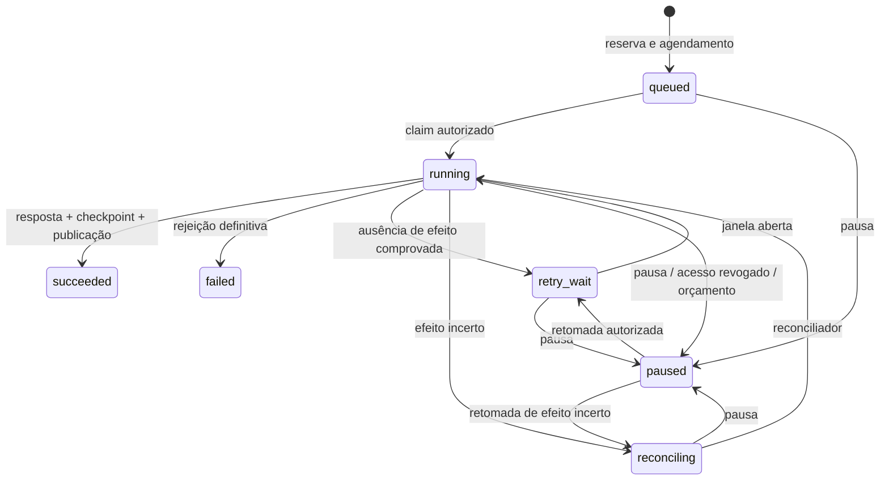

# Operações persistidas

Contrato B05 da gestão de operações em `platform/convex`. O domínio reserva uma operação e
seu agendamento na mesma mutation. As operações usam Workpool 0.4.12 com
três componentes distintos: importação 4, captura 2 e webhook 4 execuções
simultâneas. A exportação tem um quarto pool próprio, `exportPool`, com 2, e a
emissão NFS-e (workload `issuance`, tarefas `documents.issue` e
`documents.cancel`) usa `issuancePool`, com 2; veja [ISSUANCE.md](ISSUANCE.md).
O blob de conteúdo de cada versão publicada (ADR 0010, B4) passa por
`contentPool`, com 2, inclusive nas novas tentativas do writer e no backfill
da B7. Cada writer regrava os totais de estoque da organização em
`capacityTotals`; sem o limite, um lote importado disparava um writer por
versão ao mesmo tempo, e os conflitos de escrita nessas linhas esgotavam as
retentativas.
Estes limites são por deployment e carga, não por organização.

## Identidade e autorização

`operations.reserve` é interna. O módulo consumidor fornece a tarefa, os
seletores autorizados, a chave da solicitação e JSON limitado a 32 KiB.
Referências de executor, reconciliador e checkpoint vêm exclusivamente do
servidor. Não existe endpoint público para escolher uma função arbitrária.

A reserva usa organização + projeto + nome da operação lógica + chave. O que
pessoas pedem no console usa o projeto do console da organização
([ADR 0005](../adr/0005-console-sem-projeto.md)); a reserva recusa operação de
pessoa em projeto de integração.
O hash SHA-256 cobre o JSON canônico, empresa e ambiente. A ordenação das
propriedades de objetos não altera o hash; arrays e tipos continuam distintos.
Pedido equivalente recupera o mesmo ID. Divergência produz
`IDEMPOTENCY_CONFLICT`, HTTP 409 via `publicError`
(`platform/convex/lib/publicErrors.ts`).
Identidade documental e SHA-256 dos bytes pertencem à importação XML e não substituem
o hash do pedido. As reservas não expiram nesta entrega.

Toda entrada revalida o ator, empresa e ambiente; para chaves, também projeto e
concessão vigente, inclusive ao recuperar uma resposta reservada. Execução
confere também as épocas do projeto e da concessão registradas na aceitação;
o projeto do console não tem concessão e registra época 0. Revogar e conceder
novamente não ressuscita trabalho antigo. A chave que aceitou o trabalho
precisa continuar válida para iniciar o próximo passo. Nenhum segredo da
chave fica na operação.

Na importação XML, a reserva pelo painel usa a sessão humana autorizada, sem criar uma
chave de API fictícia, no projeto do console. Registra membership e versão de
acesso à empresa. Execução confere papel com escrita, membership e essa versão,
além da época do projeto. `recordOutcome` revalida acesso antes de aceitar o resultado;
revogação após `beginEffect` pausa o trabalho. As provas de ambas as entradas
estão em `platform/convex/imports.test.ts` e no recorte importação XML.

Pessoas usam Better Auth e `humanAccess`/`memberAccess`, sem concessão de
projeto. Consultam operações de qualquer projeto da empresa, mas só pausam e
retomam as do projeto do console; a operação de uma integração responde
`INTEGRATION_RECORD` e é gerida por ela (`POST /v1/operations/:id/pause|retry`).
Owner/admin alcançam todas as empresas da organização; operator, as empresas
concedidas a ele; viewer consulta, sem intervenção. Developer só
alcança operações de projetos que administra, pela concessão desse projeto, e
só intervém em trabalho com `webhooks:manage`. A retomada ainda passa pela
revalidação de execução: uma operação aceita por chave depende da chave e da
concessão do projeto dela.

Depois da reativação de uma organização do arquivo econômico, as rotas de
operação aceitam o ID anterior, resolvido pelo mapa da organização da chave,
e respondem a operação atual com `originalId`, o primeiro ID
([SDK.md](../v1.0/SDK.md#ids-depois-da-reativação)). A repetição de um pedido
com a mesma chave de idempotência compara o ID como foi enviado e devolve a
operação sob o ID novo.

## Estados e posse da execução

Cada claim recebe generation + fence e lease de 60 segundos. Todas as
gravações de resultado exigem a geração e o fence atuais, estado running
e lease ainda válida. Resultado tardio é recusado inclusive antes de a
recuperação criar outra geração. Pausar invalida a geração e cancela trabalho
pendente; uma chamada externa que já começou pode terminar.

As etapas persistidas são ready, calling, response e checkpoint. A mutation
`beginEffect` revalida acesso antes de passar para calling. O executor recebe
operationId, generation, fence e request. O reconciliador recebe o mesmo
contrato e deve consultar o efeito anterior, sem retransmitir implicitamente.

O domínio pode fornecer `onSucceeded`, uma mutation interna executada na mesma
transação que grava `state: succeeded` e os recibos finais. A importação XML usa esse
callback para indexar versões visíveis no histórico. Não aceita referências
vindas do cliente e não chama efeitos externos.

| Resultado do adaptador | Comportamento                                                      |
| ---------------------- | ------------------------------------------------------------------ |
| success + response     | Persiste resposta limitada a 32 KiB; avança para checkpoint        |
| transient + code       | Retenta com backoff, somente quando o adaptador comprova segurança |
| uncertain + code       | Usa reconciliador; sem reconciliador, pausa                        |
| absent + code          | Ausência observada mantém reconciliação; não libera execução       |
| definitive + code      | Encerra com falha definitiva                                       |

Falha transitória e ausência observada pelo reconciliador preservam a incerteza.
Uma chamada antiga pode produzir o efeito depois da consulta. Mesmo que o
worker termine, a fonte pode continuar processando a requisição. Este protocolo
nunca retorna da reconciliação para a execução original; ele consulta novamente
ou pausa ao esgotar o orçamento. Exceção ou queda
durante calling também exige reconciliação. Não há promessa de exactly-once
para efeitos externos. Adaptadores precisam respeitar o fence e a janela
antes de cada novo efeito; a infraestrutura não cancela uma requisição já enviada.

O checkpoint opcional é uma mutation interna que recebe operationId e
response. Suas escritas e a passagem para checkpoint são uma transação sob
o fence atual. Ela deve aplicar as regras de identidade documental do módulo.
A publicação cria um recibo lógico de resultado e um de consumo por operação,
atomicamente com succeeded. São recibos da operação, ainda sem agregação de
cobrança ou entrega de outbox. Tentativas têm registros distintos.

## Recuperação e limites

Próxima data, backoff e jitter ficam no banco. O scheduler só entrega ao
Workpool depois da data exata, pois o componente agrupa horários em segmentos.
Nenhuma action dorme aguardando janela. Retry automático do Workpool fica
desativado; o domínio decide se pode repetir ou precisa reconciliar.

Cada operação tem watchdog persistido. `recoverBatch` consulta o índice
`by_recoveryAt`, com no máximo 20 operações por chamada. Não lê operações
terminais ou futuras nem varre a base. Trabalho ainda pendente no pool é
observado sem reenfileiramento duplicado. O watchdog não depende de cron;
`FNFE_CRONS=off` permanece aplicado ao ambiente local e de validação.

O orçamento é de seis chamadas de execução/reconciliação e doze recuperações.
Retomar resposta/checkpoint não repete a chamada externa. Esgotamento pausa;
retry manual não reinicia orçamento nem antecipa a próxima data.
Intervenções geram auditoria, sem request, XML, credenciais ou stack.

Operação incerta com reconciliador não fica presa ao esgotar as seis
chamadas. Retomá-la, pelo console ou por `POST /v1/operations/:id/retry`,
concede exatamente uma reconciliação além do limite: `maxAttempts` passa a
`attempts + 1`, o histórico de tentativas fica intacto, o estado vai a
reconciling e a auditoria registra `retry_requested` e `MANUAL_RECONCILE`.
A tentativa roda em modo reconcile, com o reconciliador, nunca com o
executor. Se a incerteza persistir, a operação pausa de novo com
`RECONCILIATION_REQUIRED`; cada retomada consome uma recuperação do
orçamento de doze (`RECOVERY_BUDGET_EXHAUSTED` ao esgotar). Sem reconciliador,
a retomada de operação incerta é recusada com `RECONCILIATION_REQUIRED`;
operação esgotada sem incerteza, com `ATTEMPTS_EXHAUSTED`.

## Contratos de consulta e controle

| Entrada                         | Contrato                                                    |
| ------------------------------- | ----------------------------------------------------------- |
| `operations.get`                | Query humana autenticada por operationId                    |
| `operations.control`            | Mutation humana com action pause/retry e expectedGeneration |
| `GET /v1/operations/:id`        | Chave de projeto com escopo da operação original            |
| `POST /v1/operations/:id/pause` | Corpo `{ "expectedGeneration": 1 }`                         |
| `POST /v1/operations/:id/retry` | Mesmo corpo; retoma somente operação pausada elegível       |

No console, gestores abrem uma operação em
`/app/:organizationSlug/operations?ref=<operationId>`; a tela mostra estado,
situação legível com o código e o controle de pausa/retomada
([OBSERVABILITY.md](OBSERVABILITY.md#investigação-por-link-e-leitura-da-trilha-no-console)).

REST exige `Authorization: Bearer ...` e `X-Environment` igual ao ambiente
da chave e da operação; outro valor responde `ENVIRONMENT_DENIED`. Em
`production` no site, só as operações que a liberação fiscal da empresa
atende, como a captura ([CAPTURE.md](CAPTURE.md#liberação-fiscal-no-site)).
Retorna `{ data, requestId }`, X-Request-Id gerado pelo servidor e Cache-Control
no-store. O DTO contém id, state, generation, attempts, nextAttemptAt,
code, result e uncertain. Result só aparece após succeeded e deve ser um
DTO seguro serializado pelo adaptador, nunca XML ou resposta externa bruta.

IDs ausentes ou de outro cliente retornam 404. Chave inválida/expirada/revogada
retorna 401; escopo ou ambiente negado, 403; versão concorrente, orçamento
esgotado ou reconciliação obrigatória, 409. Corpo inválido retorna 400.
Retry de operação cuja autorização original foi revogada retorna
`ACCESS_REVOKED`, 409, antes de alterar estado ou consumir orçamento.

O escopo da operação original é o `task.scope` gravado, exceto nas operações
de emissão (workload `issuance`): `documents.issue` exige `documents:issue` e
`documents.cancel` exige `documents:cancel`, na chave e na concessão, mesmo
que a operação tenha sido gravada com `documents:import` antes da #206
(`requiredScope` em `lib/operationAccess.ts`). A mesma regra vale para a
revalidação do executor e para developers em `operations.get` e
`operations.control`; as demais pessoas não dependem de escopo de concessão
([ISSUANCE.md](ISSUANCE.md#acesso-e-escopos)).

## Provas e integração dos módulos

`platform/convex/operations.test.ts` exercita transações, tokens, permissões,
estados e recuperação. `node scripts/proofs/prove-operations.mjs` exige este worktree
com `bun run dev`, usa fonte HTTP loopback e inspeciona o banco real.
`testing/operationProof` e `testing/operationTransport` são funções internas
recusadas fora do ambiente local, com dados exclusivamente sintéticos.

A importação XML, a outbox e a captura NF-e já consomem esse protocolo. Cada
módulo conserva seu contrato e aceite. A prova própria de operações usa um
documento sintético no checkpoint; não substitui as provas desses módulos ou
a autorização do fisco. O aceite técnico B05
consolida a matriz de falhas, os testes atuais e a repetição no Convex local,
preservando os recibos originais.

`documents.reprocess_refusals` (#499, `refusalReprocess.ts`) é pedida só pelo
console, por empresa e ambiente, por owner, admin ou operator, no workload de
importação. Enquanto a execução da empresa e ambiente está viva (não terminal,
pausada enquanto uma pessoa ainda pode retomá-la, ou concluída com filha
pendente), repetir o pedido a
devolve; depois, o pedido abre uma nova, que só pega o que sobrou. Um registro
`current:<empresa>:<ambiente>` em `idempotencyRecords`, lido e reescrito na
transação do pedido, impede que dois pedidos simultâneos abram duas execuções.
O ambiente é conferido para `capture-processing` (`environmentPurpose`), como
o processamento do que a captura já recebeu. O reconciliador é o próprio
executor. Nenhum desfecho deliberado vira falha de fonte: a espera entre
páginas (`SWEEP_CONTINUES`) é `wait` e `ACCESS_REVOKED` é uma decisão. Uma
lease perdida não é registrada pelo executor; a recuperação a trata como
qualquer execução perdida (`EXECUTION_LOST`): conta como uma nova tentativa,
gasta uma recuperação e grava uma linha em `operationalFailures`.

O executor lê uma página por tentativa e guarda cursor e total em
`operations.refusalSweep`, na mesma transação das filhas; perder a lease não
perde o progresso, e a recuperação retoma do cursor. Cada original vira uma
operação filha (`continueOperation`, com a pessoa como origem), registrada em
`idempotencyRecords` como `<execução>:<artefato>` e `latest:<artefato>`.
Ritmo: as filhas de uma página começam uma a cada 2 segundos (`nextAttemptAt`
escalonado), e a página seguinte só é lida depois que a última filha começou,
pelo desfecho `wait`, que não gasta tentativa. Assim uma empresa põe no
`importPool`, compartilhado pelo deployment, no máximo uma filha nova a cada 2
segundos, e as importações das outras organizações continuam entrando. O ritmo
é por empresa e ambiente, não global: várias empresas pedindo ao mesmo tempo
somam as filhas no pool. A operação termina quando a última página foi lida;
o resultado de cada filha é lido dela
([IMPORTS.md](IMPORTS.md#recusas-técnicas-de-um-leitor-anterior)).
